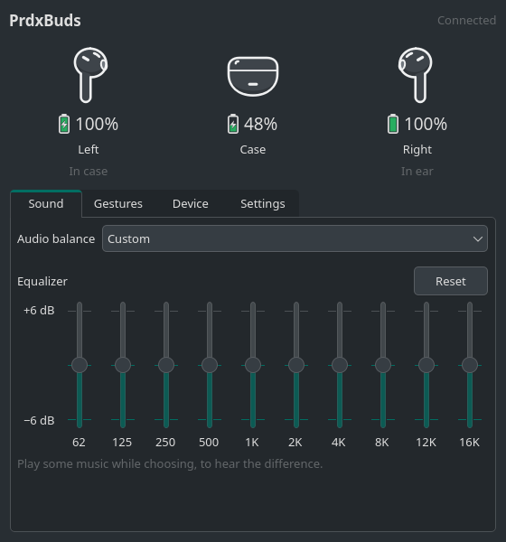
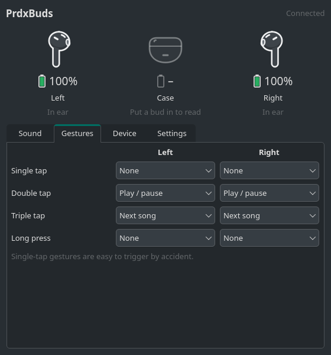
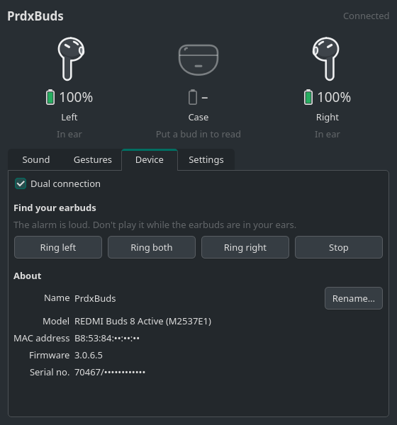
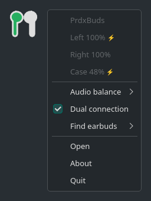

<h1></h1>

Desktop application for controlling your Xiaomi earbuds, like the official
Android app but for your computer. It was reverse engineered from that app and
talks to the buds over Bluetooth with Xiaomi's own protocol. It shows the battery
of each bud and the case in the system tray and lets you change the buds'
settings.

This is a personal project. Xiaomi only makes the companion app for phones, and
I wanted to manage my own REDMI Buds 8 Active from KDE. I'm building it for that
pair, and supporting every Xiaomi earbud model isn't a goal. mebuds doesn't need
a Xiaomi account or an internet connection; everything happens between your PC
and the buds.

<p align="center">
  
  
</p>
<p align="center">
  
  
</p>

## Features

The tray icon shows the two earbuds, each filled up to its battery level. It
turns green while they charge and red when one runs low. Hover it for exact
percentages, or right-click it to change the audio preset, toggle dual
connection or make the buds ring.

The window has the rest:

- battery for each earbud and the case, and whether each bud is in your ear or
  in the case
- audio balance presets and the 10-band custom equalizer
- touch gestures for each earbud
- dual connection
- find your earbuds (ring left, right or both)
- rename, firmware version, serial number

mebuds connects to the buds' control channel by itself when they connect to
your computer, and lets go when they disconnect. It shows a notification with
the battery levels when they connect, and can warn you when an earbud's battery
gets low.

It has its own look, based on KDE's Breeze, so it's the same on every system.
It's light or dark following your system's setting. Start it with
`--native-style` to use your desktop's widget style instead.

It's available in English, Catalan, Spanish, French, German, Italian,
Portuguese (Brazil), Russian and Simplified Chinese. It follows the system
language, or you can pick one in Settings.

The buds accept only one control connection at a time. While the Xiaomi app on
your phone is connected to them, mebuds can't get in; it keeps retrying and
picks up once the phone lets go.

## Download

Builds for every release are on the [Releases](../../releases) page:

| System | File |
|--------|------|
| Linux, x86_64 | `mebuds-<version>-linux-x86_64.AppImage` |
| Linux, ARM64 | `mebuds-<version>-linux-aarch64.AppImage` |
| Windows, x64 | `mebuds-<version>-windows-x64.zip` |
| Windows, ARM64 | `mebuds-<version>-windows-arm64.zip` |

**I have only tested the Linux x86_64 build.** The ARM64 and Windows builds come
out of the same automated build and pass its tests, but I haven't run them on a
real machine. Windows in particular has its own Bluetooth code, which so far has
only run on build servers that have no Bluetooth at all.

Pair and connect the earbuds in your system's Bluetooth settings first, then:

- **Linux:** make the AppImage executable and run it:
  `chmod +x mebuds-*.AppImage && ./mebuds-*.AppImage`. It uses BlueZ, the
  standard Linux Bluetooth stack, and doesn't need root.
- **Arch Linux / Manjaro:** the package from `packaging/arch` installs mebuds
  with a menu entry, using the system's Qt:

  ```
  git clone https://github.com/paradox-ng/mebuds
  cd mebuds/packaging/arch
  makepkg -si
  ```
- **Windows:** extract the zip and run `mebuds\mebuds.exe`.

To have it start when you log in, turn on *Start mebuds when you log in* in the
Settings tab. By default it then starts in the tray without opening the window.
If you start it some other way, `--hidden` does the same; `--help` lists the
other options.

## Battery on the command line

While mebuds is running, `mebuds --status` prints the battery levels and
`mebuds --status --json` prints everything it knows. It asks the running copy,
so it doesn't open another connection to the earbuds. It exits with 0 when the
earbuds are connected, 2 when they aren't and 1 when mebuds isn't running.

```
$ mebuds --status
PrdxBuds: L 100%  ·  Case 72%  ·  R 95%
```

That makes it easy to put the battery in a status bar. For Waybar:

```json
"custom/earbuds": {
    "exec": "mebuds --status",
    "interval": 60
}
```

In KDE Plasma, the *Command Output* widget from the KDE Store can run the same
command.

## Supported devices

**I have only tested mebuds with my own REDMI Buds 8 Active (M2537E1).** Its
feature list matches what the official app shows for that model.

It should also work with the other earbuds the official Xiaomi Earbuds app
supports. The app uses the same connection, handshake, battery reports and
settings commands for all of them, and mebuds speaks that same protocol. What
differs per model is which settings exist. The official app gets each model's
list from Xiaomi's servers, and the firmware answers settings the hardware
doesn't have (my pair accepts ANC commands, then ignores them), so asking the
buds isn't a reliable way to find out. That's why, on models other than mine,
mebuds shows only battery and device info.

A few older models use extra vendor-specific commands and might not connect at
all. I can't check that without the hardware.

### Adding your earbuds

mebuds is open source, so anyone can add support for their own earbuds and send
it as a pull request. For a model that already connects, this is usually just
an entry in `MODELS` in `mebuds/features.py`, keyed by the product ID mebuds
shows under Device → Model. Copy the features the official app shows for your
model: which audio presets, which gestures and the actions each one offers,
dual connection, find earbuds. Starting mebuds with `--debug` logs every packet,
which helps if your model needs something new. [docs/PROTOCOL.md](docs/PROTOCOL.md)
describes the protocol.

## Translations

The translations live in `mebuds/data/i18n` as Qt `.ts` files, which you can
edit in Qt Linguist or any text editor. No native speaker has checked them yet,
so corrections are very welcome. After changing a translation, or the strings
in the code, run `tools/update_translations.sh` to update the files and compile
them. To start a new language, create its file with
`pyside6-lupdate mebuds/*.py -ts mebuds/data/i18n/mebuds_<code>.ts`, fill it in,
and run the script.

## Running from source

You need Python 3.10 or newer and PySide6:

```
pip install PySide6
./run.sh            # or: python -m mebuds
```

`pip install .` installs it as a `mebuds` command. On Linux, Python has to be
built with Bluetooth socket support; `python3 -c "import socket;
socket.AF_BLUETOOTH"` prints nothing if it is.

The tests use packets captured from real earbuds: `pip install pytest` and run
`pytest`.

## Building

`python packaging/build.py` builds for the machine it runs on: an AppImage on
Linux, a zip on Windows. It needs PyInstaller on top of PySide6, and output goes
to `dist/`.

## Disclaimer

mebuds is not affiliated with or endorsed by Xiaomi. This repository contains no
part of the official app, only an independent implementation of the protocol.

## License

GNU General Public License v3.0 or later. See [LICENSE](LICENSE).
